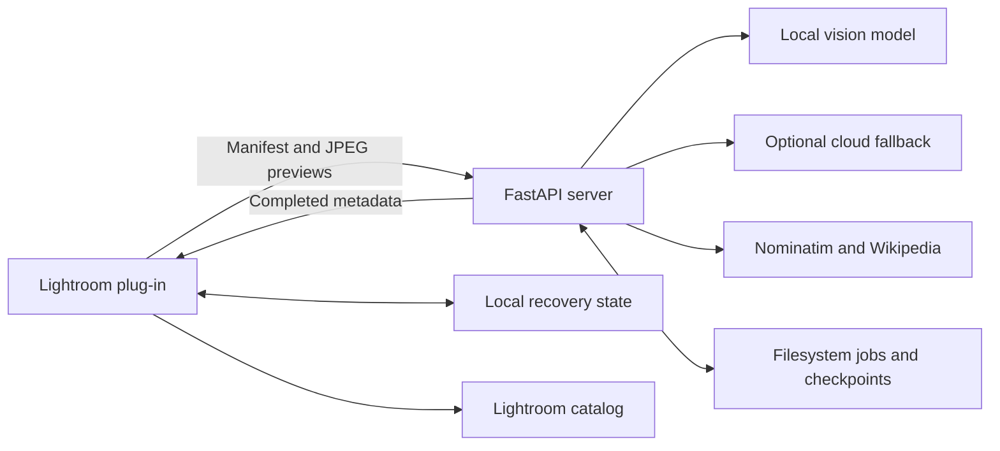

# LR Stock Metadata Server

Generate titles, captions, keywords, and agency-routing metadata for photos
in **Adobe Lightroom Classic**, using a local vision model and optional cloud
fallback. This tool edits catalog metadata, not Develop settings, and does not
upload submissions to stock agencies.

The project has two parts: a Lightroom plug-in and a Python FastAPI server.
Submit previews as a background job, then use a second Lightroom command to
download and apply the finished metadata.

## Contents

- [Requirements and compatibility](#requirements-and-compatibility)
- [Setup](#setup)
- [First job: one-photo walkthrough](#first-job-one-photo-walkthrough)
- [Metadata written and limitations](#metadata-written-and-limitations)
- [Architecture and data flow](#architecture-and-data-flow)
- [Agency routing](#agency-routing)
- [Recovery and rollback](#recovery-and-rollback)
- [Updating an installation](#updating-an-installation)
- [Troubleshooting](#troubleshooting)
- [Privacy, development, and license](#privacy-development-and-license)

## Requirements and compatibility

| Component | Requirement and evidence |
|---|---|
| Lightroom | Lightroom Classic, separately installed and licensed. The plug-in declares SDK/minimum 6.0 and version 1.1.0. No tested Lightroom release matrix is established. |
| Python | Source uses Python 3.10+ syntax. The existing Windows Python 3.14.4 environment passed 43 mocked/unit tests during this documentation review; other versions were not tested in this review. |
| Model server | LM Studio or a compatible OpenAI-style endpoint with an image-capable model loaded. Model IDs are configurable, not a tested compatibility list. |
| Photos | Lightroom must be able to export JPEG previews with readable GPS EXIF. The current metadata path rejects previews without GPS. |
| Network | Model server access plus configured location lookups. Disabling cloud AI fallback does not make the pipeline offline. |

Model weights and inference runtimes are not bundled. Hardware requirements
depend on the model. Automated tests do not establish metadata accuracy, actual
Lightroom application behavior, or a real model/version compatibility matrix.

## Setup

### 1. Install the server

In PowerShell:

```powershell
git clone https://github.com/emadaljumah-camel/lr-stock-metadata-server.git
cd lr-stock-metadata-server
python -m venv .venv
.\.venv\Scripts\python.exe -m pip install -r server\requirements.txt
```

Use a Python interpreter meeting the requirements above. Run subsequent server
commands from the repository root. For an existing installation, preserve its
environment and follow [Updating an installation](#updating-an-installation).

### 2. Configure the model and server

The tracked [server/config.yaml](server/config.yaml) is the default configuration.
For machine-specific settings, copy it **outside the repository** and select
that copy with `LR_METADATA_CONFIG`. For example, on first setup:

```powershell
$settingsFolder = Join-Path $env:LOCALAPPDATA "LRStockMetadata"
New-Item -ItemType Directory -Force -Path $settingsFolder | Out-Null
Copy-Item server\config.yaml (Join-Path $settingsFolder "config.yaml")
$env:LR_METADATA_CONFIG = Join-Path $settingsFolder "config.yaml"
```

Do not recopy over an existing private configuration. This environment variable
applies to the current shell and processes started from it; set it again or
persist it deliberately for later launches.

Edit these entries in that configuration, keeping the other sections:

```yaml
server:
  host: "localhost"
  port: 8003

models:
  lm_studio_base_url: "http://localhost:1234/v1"
  hybrid_local_model: "YOUR-EXACT-LOADED-VISION-MODEL-ID"
  allow_cloud_fallback: false
```

Load an image-capable model in LM Studio and start its API server. Replace the
placeholder with the exact ID exposed by that server:

```powershell
Invoke-RestMethod http://localhost:1234/v1/models
```

**Nonempty YAML values take precedence over environment variables**, then
built-in defaults apply. This differs from many applications. An environment
variable will not override an already populated YAML setting. The selected
configuration is read at import/startup; restart after changes.

The committed configuration uses port **8003**, but the plug-in's initial URL
uses **8008**. Set the plug-in URL explicitly in step 4. If no configuration is
available, the backend's built-in port fallback is also 8008.

### 3. Start the server

From the repository root, in the shell containing your configuration selection:

```powershell
.\run_server.bat
```

The launcher reads host/port from the selected server configuration and uses
the repository's virtual environment. Leave the server and model runtime
running. Check availability in another shell:

```powershell
Invoke-RestMethod http://localhost:8003/health
```

Expect `status: ok`. Health does not verify image inference, GPS, geocoding,
or agency-review completion.

### 4. Install and configure the Lightroom plug-in

1. In Lightroom Classic, open **File > Plug-in Manager > Add**.
2. Select the complete
   [LRStockMetadata.lrplugin](lightroom-plugin/LRStockMetadata.lrplugin/) folder.
3. Select **05 LR Stock Metadata**.
4. Under **LR Stock Metadata Server**, set **Server URL** to
   `http://localhost:8003`. Do not add `/health` or `/jobs`.
5. Check **Local job storage**. Its default is **LR Stock Metadata Jobs**
   under your Documents folder.

Saved Lightroom preferences override `PluginConfig.lua`. Editing that source
file does not replace a previously saved URL.

For two computers, bind the server to a reachable private interface, restrict
firewall access to the Lightroom computer, and use its private server address
instead of localhost. Keep LM Studio private. The API has no authentication or
built-in TLS; do not expose it to the public internet. See [SECURITY.md](SECURITY.md).

### Optional cloud fallback

Keep `allow_cloud_fallback: false` if you do not want cloud AI fallback.
To enable it, select `gemini` or `openai` as `fallback_provider` and configure
its model. Leave YAML API-key entries blank and supply credentials through
`GEMINI_API_KEY` or `OPENAI_API_KEY`. A populated YAML key takes precedence.

Fallback can transmit previews and processing context to a cloud provider and
incur charges. Independently, GPS-based lookups can contact Nominatim and
Wikipedia even with fallback disabled. See [data handling](SECURITY.md#data-handling).

## First job: one-photo walkthrough

Use a backed-up test photo with readable GPS and a correct capture date.

1. Select the photo in Lightroom's Library module.
2. Run **Library > Plug-in Extras > Generate Stock Metadata**.
3. Choose **Overwrite** or **Skip Existing** in the metadata prompt.
4. Wait for the job-queued acknowledgment. No catalog metadata is changed by
   submission.
5. Keep the server and model running. After acknowledged submission, Lightroom
   can be closed or disconnected while the server processes.
6. Reconnect and run **Check Job Status / Apply Results**.
7. If still running, check again later. For a completed job, this command
   validates and applies the downloaded results; there is no separate
   per-photo recommendation approval screen.
8. Inspect title, caption, keywords, and Instructions in Lightroom.

The example does not promise particular wording or agency acceptance. Review
names, dates, locations, trademark/release implications, and keyword accuracy.
The current overwrite choice is made during submission; check-results is an
application command, not a read-only preview.

## Metadata written and limitations

| Field | Application behavior |
|---|---|
| Title | Replaced by generated title |
| Caption | Replaced by generated description |
| Keywords | Generated keywords are added; existing keywords are not cleared |
| Instructions | Replaced by the generated agency-routing tag |
| Editorial/commercial | Returned classification; do not infer a dedicated Lightroom release field was updated |

**Skip Existing** excludes photos having a title, caption, or keyword at
submission time. Instructions alone do not trigger that test. **Overwrite**
allows those photos into the job, but keywords are still added rather than
replaced. The prompt's wording is broader than the actual keyword behavior.

The plug-in does not write GPS, capture date, city, country, releases, or Develop
adjustments back to Lightroom. Location/date context contributes to generated
text. It does not submit files to Getty, Adobe Stock, or Shutterstock.

The current hybrid path requires GPS extracted from the preview itself;
passing context coordinates is not a substitute for missing preview EXIF.
Previews are JPEG, exported into a 1200-by-1200 bounding box with metadata
preservation requested. Original-format eligibility depends on Lightroom
export; there is no documented complete source-format matrix or dedicated
video workflow.

## Architecture and data flow



AI proposes metadata; server contracts and routing policies constrain it;
Lightroom validates downloaded result membership/types and performs catalog
writes. Unlike AutoDevelop-AI, this application has **no learning database**.

Durable IDs, upload hashes, photo checkpoints, cached results, and a local
applied-job flag reduce repeated work. They do not make server files and catalog
writes a single transaction. See [architecture, design, and workflow](docs/ARCHITECTURE.md).

## Agency routing

The Instructions field contains one of:

- `agency:getty_editorial`
- `agency:getty_commercial`
- `agency:adobe_shutterstock`
- `agency:shutterstock_editorial`

The initial metadata pass establishes editorial/commercial classification.
Optional comparative review can change destination while preserving that
classification. Sequence review uses merit, technical thresholds, and diversity;
the Getty ratio is a planning target, not a quota or acceptance guarantee.
See [routing configuration and pipeline](server/README.md#processing-and-routing).

## Recovery and rollback

Only one active client job is tracked at a time. Use
**Check Job Status / Apply Results** before creating a replacement.

| Situation | Behavior |
|---|---|
| Upload response lost | Recover the saved job; acknowledged previews need not be uploaded again |
| Server running | Check later; there is no running-job cancel endpoint |
| Failed/interrupted server job | Choose Resume Job; completed photo/review checkpoints can be reused |
| Failed/interrupted job no longer wanted | More Options offers confirmed deletion of server artifacts and local previews |
| Result downloaded but application failed | Cached results remain for retry; inspect possibly changed photos first |
| Job marked applied | Ordinary rechecking does not apply it again |

Application uses **batches of 25 photos**, not a single all-or-nothing batch.
Earlier writes can remain if a later batch fails. A local applied flag is saved
after the entire operation, so interruption can leave partial catalog changes
without that flag. There is no saved per-photo pre-edit snapshot or automatic
metadata rollback. Retrying can overwrite newer title/caption/Instructions.

Cancelling an export/upload dialog stops that client activity; it does not
cancel server work already queued. Deleting a job does not undo catalog changes.
Use Lightroom's available Undo/History or catalog backup as appropriate, and
verify restoration. Photo-edit History alone should not be assumed to recover
all catalog metadata.

## Updating an installation

1. Finish the active job or resolve it before updating. Stop the server and
   close/reload Lightroom as appropriate.
2. Back up the catalog, private YAML, configured job directories, local
   plug-in state, and any required API upload artifacts.
3. Check `git status --short` and preserve local edits. For a clean checkout,
   use `git pull --ff-only`; do not discard changes to force an update.
4. Keep the existing virtual environment and run
   `.\.venv\Scripts\python.exe -m pip check`. Review requirement changes
   separately; these update instructions do not upgrade dependencies.
5. If the plug-in loads from this checkout, reload it in Plug-in Manager or
   restart Lightroom. If installed as a separate copy, update the complete
   plug-in folder with Lightroom closed, preserving configured job storage.
6. Preserve private configuration and reselect `LR_METADATA_CONFIG` before
   restarting. Do not overwrite it with the tracked default.
7. Check health and run one complete GPS-enabled test job before a large batch.

There is no promised migration compatibility for every historical job snapshot.
Keep backups and avoid mixing server/plug-in versions during an active job.

## Troubleshooting

| Problem | Check |
|---|---|
| Cannot connect | Match plug-in URL to server port 8003, not the initial 8008 default |
| Environment setting ignored | Nonempty YAML takes precedence; check selected config and restart |
| Missing GPS error | Verify exported preview contains GPS EXIF; context alone is insufficient |
| Health works but generation fails | Check model ID, image support, GPS, location lookups, and server errors |
| Existing photos skipped | Choose Overwrite deliberately; Skip Existing tests title/caption/keywords |
| Metadata unchanged after submission | Run Check Job Status / Apply Results |
| Stuck active job | Recover/check it; failed/interrupted jobs offer resume or confirmed deletion |
| Apply error | Inspect partial writes; cached results can be retried without regeneration |
| Cloud fallback fails | Check enabled flag, provider/model, and blank-YAML/environment key handling |

## Privacy, development, and license

Previews can contain GPS and other embedded metadata. Server jobs, raw model
diagnostics, uploaded images, and local recovery artifacts can be retained.
There is no automatic retention period or application-level encryption.
See [SECURITY.md](SECURITY.md) before sharing data or enabling network access.

Run the automated suites from the repository root:

```powershell
.\.venv\Scripts\python.exe -m unittest server.test_async_jobs server.test_agency_reviewer -q
```

These use mocks and synthetic fixtures. The separate `server/test_client.py`
is a manual live-server utility, not a self-contained unit suite.
See [CONTRIBUTING.md](CONTRIBUTING.md), [server API documentation](server/README.md),
and [plug-in guide](lightroom-plugin/LRStockMetadata.lrplugin/README.md).

Original project code and documentation use the [MIT license](LICENSE).
External libraries, services, models, Adobe software, and data have separate
terms; see [THIRD_PARTY_NOTICES.md](THIRD_PARTY_NOTICES.md).
