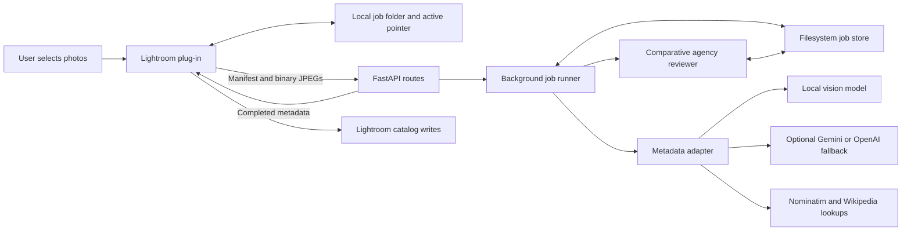
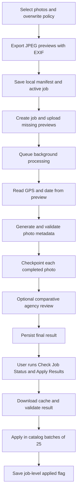

# Architecture, design, and workflow

This describes the current implementation, not a proposed redesign. Start with
the [setup and walkthrough](../README.md#setup) for ordinary use.

## Components

| Component | Implementation |
|---|---|
| Submission | [GenerateStockMetadata.lua](../lightroom-plugin/LRStockMetadata.lrplugin/GenerateStockMetadata.lua): overwrite choice, photo selection, preview export, manifest, and queueing |
| Transport/state | [JobClient.lua](../lightroom-plugin/LRStockMetadata.lrplugin/JobClient.lua) and [JobState.lua](../lightroom-plugin/LRStockMetadata.lrplugin/JobState.lua): upload acknowledgment and local recovery files |
| Review/application | [CheckJobStatus.lua](../lightroom-plugin/LRStockMetadata.lrplugin/CheckJobStatus.lua): status/recovery, cached results, catalog checks, and metadata writes |
| API | [main.py](../server/main.py): health, synchronous generation, durable jobs, uploads, status/results, and deletion |
| Persistence/execution | [job_store.py](../server/job_store.py) and [job_runner.py](../server/job_runner.py) |
| Metadata generation | [photo_metadata_adapter.py](../server/photo_metadata_adapter.py): preview EXIF, location lookup, local inference/cloud fallback, normalized metadata |
| Agency review | [agency_reviewer.py](../server/agency_reviewer.py): sequence windows, quality/merit, diversity, review/recovery checkpoints |
| Model validation | [structured_model.py](../server/structured_model.py), [models.py](../server/models.py), and [job_models.py](../server/job_models.py) |

There is no learning database or model-training component. Durable server
storage is filesystem-based. Lightroom owns catalog changes; the server and
model do not write the catalog directly.

## Design: recommendation, validation, application

Models generate text and classification/quality judgments. Server code parses
responses, validates typed structures, normalizes fields, and enforces routing
rules. Comparative review can change agency destination without changing the
initial editorial/commercial classification. This is not a guarantee of factual
accuracy, legal release status, or acceptance by a stock agency.

The plug-in verifies downloaded job/photo membership and expected metadata
types, resolves photos in the submitting catalog, then writes title, caption,
keywords, and Instructions. It does not have AutoDevelop-AI's per-photo editing
confirmation or stale-Develop-state check. A completed check command can apply
results directly. The overwrite/skip decision is taken during submission.

### Workflow

This shows the successful path. Export, missing GPS, inference, review, network,
validation, catalog access, and persistence failures can interrupt it.
The server can complete while the Lightroom computer is disconnected only
after it has acknowledged the queued submission; the server/model still run.

### Image and location behavior

The plug-in exports JPEGs into a 1200-by-1200 bounding box at quality 0.80,
requests all embedded metadata, and explicitly keeps location metadata.
Generation extracts GPS from preview EXIF and raises an error if it is missing.
Context coordinates do not replace that requirement in the current code path.
Capture date is extracted for description context, so accurate EXIF matters.

Nominatim reverse lookup and Wikipedia geosearch provide location candidates.
These are external network calls independent of optional cloud AI fallback.
The configured provider/model determines where inference data is sent. This is
not a fully offline pipeline by default.

## Durable storage

| Storage | Contents and lifetime |
|---|---|
| Lightroom Documents/LR Stock Metadata Jobs by default | Local manifest, previews, active pointer, downloaded completed result, and applied marker |
| Server `_jobs/` by default | Manifest, upload hashes, JPEGs, status, photo checkpoints, agency-review state, model-failure diagnostics, final result |
| Server `_uploads/` | Synchronous endpoint uploads; not automatically unlinked after the response |
| Resized inference artifacts | The adapter can create `_resized_for_ai/` intermediates alongside processing data |

Server relative paths resolve from the process working directory; launch from
the repository root to get the documented default locations. Manifests can
include catalog paths, filenames, context, and IDs. There is no automatic
retention policy or application-level encryption.

Individual server file writes use temporary files and atomic replacement.
This does not turn a collection of files or catalog batches into a single
transaction. Active worker bookkeeping is process-local; use one Uvicorn
process with the filesystem store, not multiple independent server processes
sharing job ownership.

### Duplicate safeguards and limits

- Client IDs plus input fingerprints reuse an identical manifest and reject
  reuse with different input.
- Preview hashes acknowledge identical uploads and reject conflicting bytes.
- Complete upload is required before queueing. The runner avoids duplicate
  active execution within its own process and returns completed state for a
  completed job rather than regenerating it.
- Photo checkpoints skip completed generation on resume. Comparative review
  has its own persisted state so review work can also be recovered.
- Results are cached before catalog writes. Catalog identity and photo/result
  membership are checked. The active job's applied flag prevents normal
  reapplication after that flag is saved.

There is no per-photo applied checkpoint. Writes occur in groups of 25, and the
applied flag is saved only after all groups succeed. If catalog writes partially
succeed, or the process stops before saving that flag, retry can reapply output.
There is no snapshot-based stale-metadata protection against later manual edits.
These mechanisms reduce duplicates; they are not a distributed exactly-once
guarantee.

## Recovery, cancellation, and rollback

| Event | Current behavior |
|---|---|
| Lost upload/queue response | Recover the saved local job identity and query/upload missing previews |
| Server restart during running job | Startup marks it interrupted; the client offers explicit Resume Job |
| Generation/review failure | Job becomes failed; completed checkpoints are retained |
| Running work no longer wanted | No server cancellation API; running jobs cannot be deleted |
| Failed/interrupted job no longer wanted | Client offers confirmed deletion of server job and local previews |
| Catalog application error | Cached result remains for retry; earlier successful writes can remain |
| Unwanted successful metadata | No dedicated rollback command; recover appropriate catalog metadata with Lightroom tools/backups and verify |

Cancelling an export/upload dialog is not equivalent to cancelling a server
job. Deletion removes stored recovery artifacts and does not undo catalog
writes. There is no automatic pre-edit metadata restoration. Keyword addition
and scalar-field replacement have different effects on a retry; review actual
state first.

## Configuration and compatibility

[config.py](../server/config.py) implements nonempty YAML, then supported
environment variables, then defaults. Settings are loaded at import/startup.
The tracked config and plug-in initial URL use different ports; the setup guide
deliberately tells users to set Lightroom to the configured server port.

The documentation review ran 43 unit/mock tests on the existing Windows Python
3.14.4 environment. The stated Python 3.10+ syntax requirement, Lightroom SDK
minimum, and configured model IDs are not a full tested compatibility matrix.
Actual Lightroom UI, GPS export, model accuracy, geocoding, and cloud fallback
need a manual one-photo check in the intended installation.

See [compatibility](../README.md#requirements-and-compatibility),
[update instructions](../README.md#updating-an-installation),
[metadata overwrite semantics](../README.md#metadata-written-and-limitations),
and [security boundaries](../SECURITY.md).
